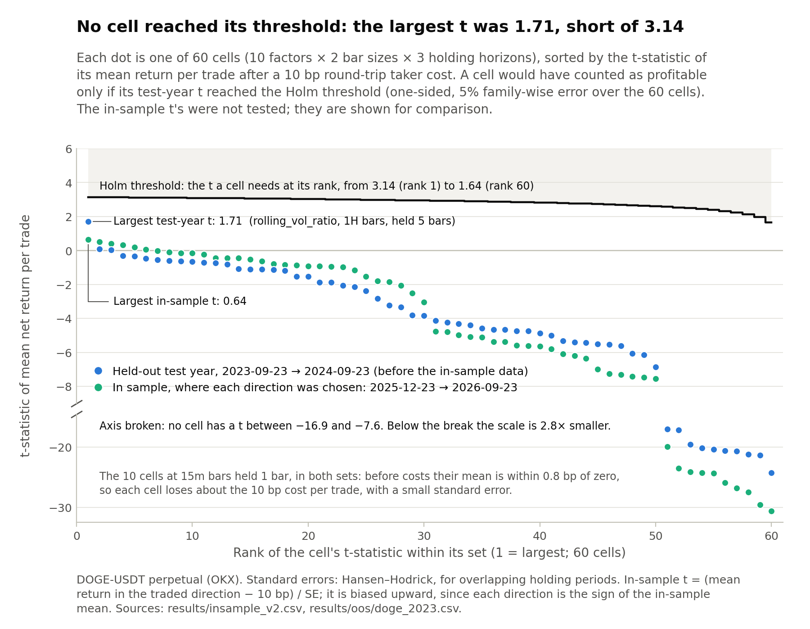

# Crypto Factor Validation

> A pre-registered out-of-sample test of ten trading factors on the OKX DOGE-USDT perpetual,
> after taker costs, and the event-driven trading engine that seven of them come from.

[](https://github.com/ikunfloyd/crypto-factor-validation/actions/workflows/ci.yml)
[](https://www.python.org/downloads/)
[](LICENSE)
[-lightgrey.svg)](https://www.apple.com/mac/)

**English** · [中文](README.zh.md)

---

**Question.** Ten trading factors (seven from the trading engine below, such as RSI, Bollinger %B
and the perpetual–spot basis, and three added for the study) × two bar sizes (15 minutes, 1 hour)
× three holding periods (1, 5 and 15 bars) give 60 trading rules, called cells, on the OKX
DOGE-USDT perpetual. A cell trades whenever its factor is in the top or bottom fifth of its own
history so far, long in one and short in the other as the in-sample year decided, enters at the
next bar's close and holds for its holding period. Can any cell be shown to earn a positive mean
return per trade after paying the taker fee twice (10 bp, 0.10%, per round trip), on data it was
not developed on?

**Answer.** No. On the primary test year (DOGE, 2023-09-23 to 2024-09-23, two years before the
in-sample year that fixed each cell's direction) the largest t-statistic was 1.71, short of the
3.144 that Holm's correction for 60 tests requires. For 40 of the 60 cells the 95% upper
confidence bound on the mean net return per trade is below zero (34 if the bound must hold for all
60 at once): charged a round trip on every signal bar, as the test charges them, those cells do
not pay at taker cost. Even before costs, and in either direction, no cell's t exceeds 2.68.

**Why trust it.** The cells, the test statistic and the threshold were published in a GitHub
Release, and each cell's trade direction was frozen in a tagged commit; Software Heritage, an
independent public archive of source code, archived both before the test sets were downloaded.
Each set was then run once, by a script that refuses to run on changed code, on inputs that differ
from their committed hashes, or when the set already has results.

<p align="center">
  
</p>

<p align="center"><sub>The 60 t-statistics, sorted within each set, in sample and on the primary
test year. The staircase is Holm's step-down threshold, 3.144 for the largest t. No cell reaches
its threshold.</sub></p>

**Other sets.** Holm's correction found no significant cell on a second DOGE year (2024-09-23 to
2025-09-23) or on BTC, ETH and SOL pooled over the primary year. On DOGE from 2026-09-23 to
2026-11-23, a descriptive set that decides nothing, no cell's two-sided 95% interval lies above
zero, and 35 of the 60 lie entirely below it.

**Cheaper execution.** On 14 in-sample days of OKX's order-book archive (400 levels a side) and
its trade archive, resting at the best price for up to a minute before crossing cut the round-trip cost,
measured from the mid-price (fees plus half the spread on each side), from about 11 bp to about
6–8 bp, adverse selection included. It cannot change the answer: no cell reaches its threshold
even at zero cost.

**What it cannot rule out.** At the longest horizon (1-hour bars held for 15 bars) the test had
80% power only against net edges of 52 to 123 bp per trade, depending on the cell, so a null there
could easily miss a real edge. One cell at a time, the 95% upper bounds there still reach only
+38 bp per trade (+72 bp if the bound must hold for all 60 cells at once). The study covers one
exchange and one fee schedule.

**The record**

- **Written down first.** The [pre-registration](docs/preregistration.md) fixed the 60 cells, the
  statistic and the decision rule, and was published as a
  [GitHub Release](https://github.com/ikunfloyd/crypto-factor-validation/releases/tag/prereg-publication)
  at 07:37 UTC on 2026-10-12, before the test sets were downloaded. Its §3 lists every earlier
  contact with test-period data, including archive files from test periods downloaded while
  planning.
- **Frozen and archived.** Each cell's direction was fixed on the in-sample year in
  `results/insample_v2.csv`, whose commit is tagged `prereg-freeze`, and copied with each cell's
  minimum detectable effect into the [freeze amendment](docs/preregistration-freeze.md). Software
  Heritage archived the publication and freeze commits at 08:55 UTC
  ([`swh:1:snp:7baf60bb…`](https://archive.softwareheritage.org/swh:1:snp:7baf60bb2da0a53f8120a3ff56074ac410fb1b28)).
  That was before the freeze amendment (09:01), which the download script requires on the public
  `main` before it fetches test data, so the archive predates every test-set download. It archived
  the repository again at 20:19 UTC on 2026-11-24, with every result, the report and the tools
  for readers ([`swh:1:snp:5175c6ab…`](https://archive.softwareheritage.org/swh:1:snp:5175c6abbc6e3cd45e0bc7d7b9c6a78de259b6c4)).
- **One run per set, guarded in code.** [`scripts/run_oos.py`](scripts/run_oos.py) refuses to run
  if any file outside `docs/` and `results/` changed after the tag, if an input file's SHA-256
  differs from the set's committed manifest, or if the set's results exist or were ever committed.
  The guards catch accidents and make any deviation a deliberate act; they cannot stop an author
  who controls the machine. That each set ran once, with no reruns, rests on the public commit
  record and on the results being reproducible from public data (Reproduce says how, and how far).
- **Read against the plan.** The [comparison](docs/preregistration-results.md) checks each result
  against what the pre-registration said would be tested and how it would be read. Departures are
  dated in the pre-registration's deviations log (§12).

**Reproduce**

Every results file and figure can be recomputed from OKX's public data, with no API key. The
scripts check the freeze through git, so they need a full clone of the public repository (not a
fork, a shallow clone or a ZIP). For the primary set:

```bash
git clone https://github.com/ikunfloyd/crypto-factor-validation.git && cd crypto-factor-validation
conda env create -f environment.yml && conda activate doge_trading
python scripts/fetch_v2.py --candles DOGE-USDT-SWAP DOGE-USDT --funding DOGE-USDT-SWAP \
    --start '2023-06-25 20:00' --end '2024-09-23 20:00' --allow-test-data \
    --out-dir data/history/oos/doge_2023 --manifest /tmp/manifest_doge_2023.json
python scripts/verify_results.py --set doge_2023
```

- **Download.** `fetch_v2.py` writes the set under the ignored `data/`. Its manifest goes to a
  temporary path because the committed one, `results/oos/manifest_doge_2023.json`, already exists
  and the script never overwrites a file. Downloading `doge_2023` and `doge_fwd` again on
  2026-11-24 reproduced every SHA-256 in their committed manifests. The commands for the other
  sets are in the script's docstring.
- **Verify.** `verify_results.py` checks every input file's SHA-256 against the committed
  manifest, recomputes the set through the code path the committed run used, and compares every
  column with `results/oos/doge_2023.csv` and its robustness file. It writes nothing. Without the
  git history and the `prereg-freeze` tag some checks cannot be made, and the verdict is
  INCOMPLETE.
- **In-sample year.** `--set insample_v2`, `--set doge_fwd` (for its warm-up) and
  `scripts/make_figures.py` read the in-sample year. Its candles came from an earlier downloader:
  a new download matches them value for value but not byte for byte, and their SHA-256 is in
  Appendix A of the pre-registration. They are not in the repository, because OKX's API Agreement
  (§9.4) does not allow its market data to be redistributed. Download the year yourself and pass
  it with `--insample-from` (`doge_fwd` also needs its own files, and the figures need `doge_2023`
  and `doge_2024`):

  ```bash
  python scripts/fetch_v2.py --candles DOGE-USDT-SWAP DOGE-USDT --funding DOGE-USDT-SWAP \
      --start '2025-09-24 00:00' --end '2026-09-23 20:00' --allow-test-data \
      --out-dir data/history/insample_fresh --manifest /tmp/manifest_insample_fresh.json
  python scripts/verify_results.py --set insample_v2 --insample-from data/history/insample_fresh
  python scripts/verify_results.py --set doge_fwd --insample-from data/history/insample_fresh
  python scripts/make_figures.py --out /tmp/figures --insample-from data/history/insample_fresh
  for f in docs/figures/*.png; do cmp "$f" "/tmp/figures/${f##*/}"; done   # prints nothing if identical
  ```

  `--allow-test-data` lets the script read OKX's monthly funding archive for September 2025 and
  September 2026, which overlap test sets; without it, September 2026 comes from OKX's REST
  endpoint, which reaches back only about three months. The spot leg comes out with the bytes the
  run read. The candles stand in by value, and so does the funding, which starts a few days
  earlier than the run's file: it is read only over the span the supplement's manifest records.
  The verdict is therefore INCOMPLETE, not PASS: every column matching shows that the committed
  results follow from OKX's public data through the frozen code, though not that the run read
  these bytes. A download on 2026-11-24 reproduced `results/insample_v2.csv` and
  `results/oos/doge_fwd.csv` byte for byte this way, and drew the four figures byte for byte as
  committed, with `environment.yml`'s matplotlib and Pillow.
- **Maker probe.** `python scripts/fetch_maker_probe.py` fetches the probe's 56 archive files
  (5.2 GB) and checks each against its committed SHA-256; `python scripts/run_maker_probe.py
  --verify` then recomputes the probe and compares every output with the committed one, apart from
  a column of run times, keeping no file.

The [report](docs/factor-research-v2.md) describes the method and every result.

## The study in more detail

| Set | Role | Instruments | Window (UTC) | Result |
|---|---|---|---|---|
| In-sample | fixes each cell's direction | DOGE-USDT-SWAP | 2025-12-23 → 2026-09-23 (warm-up from 2025-09-24) | 31 cells buy the factor's top fifth and sell its bottom fifth, 29 the reverse; none flagged for too few trades or a missing input |
| `doge_2023` | primary: decides | DOGE-USDT-SWAP | 2023-09-23 → 2024-09-23 | 0 of 60 confirmed; largest t 1.71 |
| `doge_2024` | replication label | DOGE-USDT-SWAP | 2024-09-23 → 2025-09-23 | Holm rejects none; largest t 2.23 |
| `majors_2023` | breadth label | BTC-, ETH-, SOL-USDT-SWAP, pooled | 2023-09-23 → 2024-09-23 | Holm rejects none; largest t 0.08 |
| `doge_fwd` | descriptive | DOGE-USDT-SWAP | 2026-09-23 → 2026-11-23 | descriptive: no interval above 0, 35 of 60 below |

The primary year comes before the in-sample year because the year in between, `doge_2024`, was
77% covered by the author's earlier research, so it can only replicate; 2023–24 is the most recent
DOGE year that research did not use (pre-registration §3, §4.1).

- [`docs/factor-research-v2.md`](docs/factor-research-v2.md): the report;
  [`docs/summary.md`](docs/summary.md) puts the study on one page.
- [`docs/preregistration.md`](docs/preregistration.md): what was fixed before the data, and the
  deviations log (§12).
- [`docs/preregistration-freeze.md`](docs/preregistration-freeze.md): the frozen directions and
  minimum detectable effects.
- [`docs/preregistration-results.md`](docs/preregistration-results.md): the results read against
  the plan. [`scripts/summarize_results.py`](scripts/summarize_results.py) recomputes every number
  the comparison takes from the committed results files.
- [`results/`](results/): the committed outputs, unedited, and the data manifests with each input
  file's SHA-256.
- [`research/`](research/): the study's code; [`scripts/fetch_v2.py`](scripts/fetch_v2.py) and
  [`scripts/run_oos.py`](scripts/run_oos.py) download and run it, and refuse to do either out of
  order.
- [`docs/factor-research.md`](docs/factor-research.md): v1, an earlier, in-sample-only version of
  the study. It found no factor that beat costs; §2 of the pre-registration says what it got wrong.

---

Seven of the ten factors are computed by functions of the trading engine this repository started as,
unchanged since the pre-registration (three were fixed before it); the research pipeline feeds them,
masks stale funding values and divides the MACD histogram by close. The next section describes that
engine, an exercise in low-latency Python plumbing (shared-memory IPC, a write-ahead log, process
supervision) that stops at simulated fills and claims no edge.

## The trading engine

### Highlights

- **Zero-copy IPC** — a hand-rolled ring buffer over `multiprocessing.shared_memory`;
  producer and consumers read the same bytes with no serialization
  ([`shared_memory/ring_buffer.py`](shared_memory/ring_buffer.py)).
- **Crash recovery** — every tick is appended to a write-ahead log *before* it
  hits shared memory, plus periodic checkpoints, so a kill -9 loses nothing
  ([`io_gateway/wal_writer.py`](io_gateway/wal_writer.py), [`utils/disaster_recovery.py`](utils/disaster_recovery.py)).
- **Async market data** — dual OKX WebSocket endpoints (public + business) with
  heartbeat monitoring and exponential-backoff reconnect
  ([`io_gateway/ws_client.py`](io_gateway/ws_client.py)).
- **Process orchestration** — a supervisor spawns each stage as its own process,
  pins it to performance vs. efficiency cores, health-checks it, and restarts it
  on death ([`orchestrator/main.py`](orchestrator/main.py)).
- **Vectorized compute** — Polars for dataframes, Numba-JIT factor kernels, and a
  three-expert LightGBM MoE with a regime-aware gating network
  ([`quant_core/`](quant_core/)).

### Try the engine in 30 seconds (offline, no keys)

The demo runs the full compute path — synthetic candles → feature engineering →
factors → MoE → trading signal — with **no exchange account, API keys, or
Apple-Silicon hardware required**. Missing models are trained automatically on
first run.

```bash
conda env create -f environment.yml      # or: pip install -r requirements.txt
conda activate doge_trading
python scripts/demo.py
```

```
[2/4] data processing + factor engine ...
      candle features : 29 columns
      factors computed: 5 -> rsi_14, macd_hist, bollinger_pctb, rolling_vol_ratio, net_taker_flow
[3/4] loading MoE experts ...
      experts loaded  : ['hunter', 'sniper', 'defender']
[4/4] inference:
  regime          : high_vol
  gating weights  : hunter=0.00, sniper=0.00, defender=1.00
  fused score     : +0.267
  -> direction    : NEUTRAL   confidence: 0.0%   position size: 0.0%

How the same features route through every regime (gating demo):
  trending  -> SHORT   conf=95.8%  pos=47.9%
  ranging   -> SHORT   conf=87.3%  pos=30.6%
  high_vol  -> NEUTRAL conf= 0.0%  pos= 0.0%
```

### Architecture

```
        OKX WebSocket (public + business)
                    │
          ┌─────────▼─────────┐        ┌────────────────────┐
          │    IO Gateway     │──────▶ │  WAL (msgpack+zlib) │  durability
          │  async ingest     │        └────────────────────┘
          └─────────┬─────────┘
                    │ write (zero-copy)
          ┌─────────▼─────────┐
          │   Shared Memory   │  ring buffers: tick (3600) · candle (5000)
          └─────────┬─────────┘
                    │ read_latest / peek_latest
          ┌─────────▼─────────┐
          │    Quant Core     │  DataProcessor → FactorEngine → MoE inference
          └─────────┬─────────┘
                    │ signal
          ┌─────────▼─────────┐
          │    Execution      │  signal fusion → risk manager → order router
          └───────────────────┘

   Orchestrator supervises every process: CPU-affinity pinning, health
   checks, auto-restart, checkpoint + WAL-replay disaster recovery.
```

Full design write-up with rationale and data-flow diagrams:
[`ARCHITECTURE.md`](ARCHITECTURE.md).

| Layer | Responsibility | Key tech |
|-------|----------------|----------|
| IO Gateway | WebSocket ingest, WAL persistence, cleaning | `asyncio`, `websockets`, `msgpack` |
| Shared Memory | zero-copy inter-process transport | `multiprocessing.shared_memory`, `numpy` |
| Quant Core | features, factors, MoE inference | `polars`, `numba`, `lightgbm` |
| Execution | signal fusion, risk, order routing | `numpy` |
| Orchestrator | process lifecycle, affinity, recovery | `multiprocessing`, `psutil` |
| Dashboard | live monitoring (read-only) | `streamlit`, `plotly` |

### Benchmarks

Measured on an Apple Silicon laptop with `python scripts/benchmark.py` (single
run, warm Numba JIT). Numbers are machine-specific — reproduce them yourself
rather than trusting the table:

| Hot path | Result |
|----------|--------|
| Ring-buffer write (shared memory) | ~1.2M items/s · 0.81 µs/write |
| `peek_latest(1)` read latency | 1.4 µs median |
| Data processing (numpy → Polars + features) | ~1.5M candles/s |
| Factor engine (candle factors, Numba) | ~68K candles/s · 30 ms per 2000-bar frame |
| MoE inference (features + predict) | 218 µs median · ~4.6K predictions/s |

```bash
python scripts/benchmark.py               # or --candles 5000 --iters 100000
```

### Running the full system

The pipeline is intended for Apple Silicon (the orchestrator pins P-/E-cores).
Each stage is also runnable standalone.

**No API credentials are required.** Market data comes from OKX's public and
business WebSocket channels, which are unauthenticated, and the pipeline stops
at simulated fills — see [Execution is simulated](#execution-is-simulated).

```bash
python -m orchestrator.main                # supervised: spawns every stage
# — or run stages individually —
python -m io_gateway.main                  # OKX ingest → shared memory + WAL
python -m quant_core.main_v2               # factors + MoE inference
python -m execution.main                   # fusion, risk, routing
streamlit run dashboard/main.py            # monitoring UI
```

Retrain the expert models at any time:

```bash
python -m quant_core.training.train_models  # writes data/models/{hunter,sniper,defender}/
```

The models play no part in the study, which tests the factors directly.

## Project layout

```
research/        the study: bars, the ten factors, statistics, freeze checks, pipeline,
                 and the maker probe's engine and archive parsers
results/         committed study outputs (write-once) and data manifests with SHA-256
docs/            pre-registration, freeze amendment, results comparison, report, figures
io_gateway/      WebSocket ingest, WAL read/write, data cleaning
shared_memory/   Arrow/numpy ring buffers over shared memory + IPC manager
quant_core/      data processing, factor engine, MoE inference, training
execution/       regime detection, signal fusion, risk, order routing
orchestrator/    process supervisor, CPU affinity, disaster recovery
dashboard/       Streamlit monitoring app
utils/           logging, health monitor, performance, recovery helpers
config/          settings (flat constants) + trading_config (dataclasses)
scripts/         demo.py, benchmark.py (engine); fetch_v2.py, run_insample_v2.py, run_oos.py,
                 maker_probe_days.py, write_freeze_amendment.py (study);
                 fetch_maker_probe.py, run_maker_probe.py (maker probe);
                 verify_results.py, summarize_results.py, make_figures.py (for readers:
                 recompute the results, the comparison's numbers and the figures; the figures
                 and the insample_v2 and doge_fwd results also read the in-sample year, which
                 a reader downloads);
                 fetch_history.py, factor_research.py (v1)
tests/           pytest suites for the engine and for the study (see Tests)
```

## Tests

```bash
pip install -r requirements-dev.txt
python scripts/demo.py --candles 500      # trains the synthetic models one test loads
pytest                                    # config in pytest.ini
pytest tests/test_ring_buffer.py -v       # a single suite
```

`tests/` holds 25 test files. Four cover the engine (factor engine, ring buffer, data processor,
MoE). The other 21 cover the study: statistics, bars, the ten factors, write-once outputs, the
pipeline, the freeze, the guards of `run_oos.py`, `fetch_v2.py` and `fetch_history.py`, the
maker probe, and the scripts for readers. They run on synthetic data and the committed results;
the few that need downloaded data are skipped when it is absent, as it is in CI.
`tests/test_spec_constants.py` checks the code's constants against the pre-registration's
Appendix A, and `tests/test_prereg_spec.py` checks that the factor functions the study reuses are
byte for byte those of the pre-registration commit.

The invariants a change must not break are in [CONTRIBUTING.md](CONTRIBUTING.md).

## Honest status

The engine is a learning project, not a production trading system. The study's claims are those
of the comparison, no more. What that means:

- **The models are trained on *synthetic* data** ([`quant_core/training/train_models.py`](quant_core/training/train_models.py)).
  The demo showcases the factor → scaling → MoE → signal *pipeline*, not a
  profitable edge. Don't read alpha into the numbers. The labels there are
  random draws with three hand-written patterns injected to make them
  learnable, so the three experts can only recover those three rules.
- **Single symbol.** The engine is wired for `DOGE-USDT-SWAP`; multi-symbol
  support would need per-symbol shared-memory segments.
- **Some factors need live feeds.** The funding-rate, open-interest, and
  order-flow factors require data the offline demo doesn't have, so they're
  skipped there; only the candle-derived factors compute.
- **Execution is simulated.** <a name="execution-is-simulated"></a>The chain
  runs market data -> factors -> MoE -> fusion -> risk -> order *sizing*, and
  then stops. [`execution/order_router.py`](execution/order_router.py) fills
  orders against the last tick with a modelled slippage curve; it never calls
  the exchange. There is no REST client, no request signing, and no private
  WebSocket channel, so nothing here can place an order even if you supply
  credentials. The `api_client` constructor argument is an unused placeholder
  for that adapter.
- **No factor was shown to beat taker costs in the pre-registered test.** On the primary test
  year no cell was significantly positive (largest t 1.71, against 3.144), and 40 of the 60
  cells have a 95% upper bound on the mean net return per trade below zero (34 if the bound must
  hold for all 60 at once). At
  the longest horizon the test had 80% power only against net edges of 52 to 123 bp per
  trade, depending on the cell, so a null there says little
  ([comparison](docs/preregistration-results.md)).
- **One exchange, one contract, one fee schedule.** The results speak to OKX's DOGE-USDT
  perpetual at taker cost. `majors_2023` covers the same year as the primary set, so it shows
  breadth across instruments, not independent confirmation.
- **The author's earlier research covered most of `doge_2024`.** It used DOGE data from about
  77% of that year, so for the factors it shared, `doge_2024` is not independent of it
  (pre-registration §3).
- **The maker probe is exploratory.** The probe of pre-registration §11 replays OKX's order book
  and trades on 14 in-sample days to ask whether resting an order at the touch beats crossing the
  spread, once adverse selection is counted. Posting for up to 60 seconds, then crossing if
  unfilled, cost 1.5 to 2.5 bp less per side than crossing at once. Its result informs only the
  discussion of cost and never replaces the 10 bp taker cost; since no cell reaches its threshold
  even at zero cost, it cannot change the study's answer.

## Disclaimer

For education and research only. Cryptocurrency trading carries substantial risk
of loss. Nothing here is financial advice, and the authors accept no liability
for any use of this software.

## License

[MIT](LICENSE).
