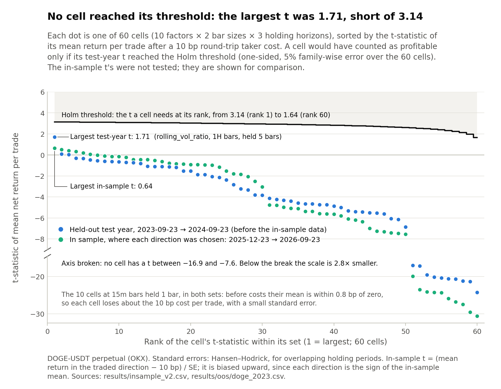

# Crypto Factor Validation

> 在 OKX DOGE-USDT 永续合约上，对十个交易因子做的预注册样本外检验（扣除吃单成本）。仓库里还有一套事件驱动交易引擎，十个因子中有七个就出自这里。

[](https://github.com/ikunfloyd/crypto-factor-validation/actions/workflows/ci.yml)
[](https://www.python.org/downloads/)
[](LICENSE)
[-lightgrey.svg)](https://www.apple.com/mac/)

[English](README.md) · **中文**

---

**问题。** 十个交易因子（七个来自下文的交易引擎，例如 RSI、布林带 %B 和永续–现货基差；另外三个是为这项研究新加的）× 两种 K 线周期（15 分钟、1 小时）× 三种持仓期（1、5、15 根 K 线），在 OKX DOGE-USDT 永续合约上组成 60 条交易规则，下文称为「单元」。因子落入自身历史的最高或最低五分之一时，单元就交易：一边做多、另一边做空（方向由样本内年份决定），在下一根 K 线收盘时入场，持有设定的根数。在开发时没有用过的数据上，能否证明其中某个单元在两次支付吃单（taker）手续费、即每次往返 10 bp（0.10%）之后，每笔交易的平均收益为正？

**答案。** 不能。在主检验年（DOGE，2023-09-23 至 2024-09-23，比确定交易方向的样本内年份早两年）上，最大的 t 统计量是 1.71，而对 60 个检验做 Holm 校正后需要达到 3.144。60 个单元中有 40 个的每笔平均净收益 95% 置信上界低于零（若要求上界对 60 个单元同时成立，则为 34 个）：按检验的算法，每根有信号的 K 线都付一次往返手续费，这些单元扣除吃单成本后不赚钱。即使不计成本、不论做多还是做空，也没有任何单元的 t 超过 2.68。

**为什么可信。** 检验单元、统计量和门槛以 GitHub Release 的形式公开，每个单元的交易方向冻结在一个打了标签的提交里；Software Heritage（一个独立、公开的源代码存档机构）在下载检验集之前存档了这两者。之后每个检验集只运行一次；运行脚本一旦发现代码有改动、输入文件与已提交的哈希不符，或该检验集已有结果，就拒绝运行。

<p align="center">
  
</p>

<p align="center"><sub>主检验年和样本内各 60 个 t 统计量，分别从大到小排序。阶梯线是 Holm 逐步检验的门槛，排在第一位的 t 需要达到 3.144。没有一个单元达到它所在名次的门槛；样本内的 t 未经检验，只作对照。</sub></p>

**其他检验集。** 在第二个 DOGE 年份（2024-09-23 至 2025-09-23）上，以及把 BTC、ETH、SOL 在主检验年的数据合并检验时，Holm 校正后同样没有任何单元显著。DOGE 在 2026-09-23 至 2026-11-23 这两个月的数据仅作描述、不参与判定：没有一个单元的双侧 95% 置信区间整体高于零，60 个中有 35 个整体低于零。

**更便宜的执行方式。** 在样本内随机抽取的 14 天 OKX 订单簿存档（每边 400 档）和成交存档上，先在最优价挂单最多一分钟、未成交再吃单，能把一次往返的成本（从中间价算起，含手续费和两边各半个价差）从约 11 bp 降到约 6–8 bp（已计入逆向选择）。但这改变不了答案：即使成本为零，也没有任何单元达到门槛。

**排除不了的情形。** 在最长的持仓期（1 小时 K 线持有 15 根）上，检验只对每笔 52 到 123 bp（视单元而定）的净优势有 80% 的统计功效，所以在那里「没有发现」很可能漏掉真实的优势。不过逐个单元看，那里的 95% 置信上界最高也只到每笔 +38 bp（若要求对 60 个单元同时成立，则为 +72 bp）。研究也只涉及一家交易所和一套费率。

**记录**

- **先公开计划，再下载检验集。** [预注册文件](docs/preregistration.md)固定了 60 个单元、统计量和判定规则，于 2026-10-12 07:37 UTC 以 [GitHub Release](https://github.com/ikunfloyd/crypto-factor-validation/releases/tag/prereg-publication) 的形式公开，早于检验集的下载。它的 §3 列出了此前每一次接触检验期数据的情况，包括规划阶段下载过的、落在检验期内的几个存档文件。
- **冻结，并独立存档。** 每个单元的交易方向由样本内年份确定，写入 `results/insample_v2.csv`，所在提交打上 `prereg-freeze` 标签；方向连同每个单元的最小可检测效应，一起抄入[冻结补充文件](docs/preregistration-freeze.md)。Software Heritage 于 08:55 UTC 存档了发布提交和冻结提交（[`swh:1:snp:7baf60bb…`](https://archive.softwareheritage.org/swh:1:snp:7baf60bb2da0a53f8120a3ff56074ac410fb1b28)）。这次存档早于冻结补充文件（09:01），而下载脚本要等冻结补充文件出现在公开的 `main` 上才肯下载检验数据，所以存档早于任何一个检验集的下载。
- **每个检验集只跑一次，由代码把关。** 只要出现以下任一情况，[`scripts/run_oos.py`](scripts/run_oos.py) 就拒绝运行：打标签之后 `docs/` 和 `results/` 以外有文件改动；某个输入文件的 SHA-256 与该检验集已提交的清单不符；该检验集的结果已经存在，或曾经提交过。这些检查能拦住失误，并让任何偏离都只能是有意为之，但拦不住掌控这台机器的作者本人。每个检验集只运行一次、没有重跑，这一点靠的是公开的提交记录，以及结果能用公开数据复现（怎么复现、能做到哪一步，见「复现」）。
- **逐条对照计划。** [结果对照](docs/preregistration-results.md)把每项结果与预注册里「检验什么、如何解读」逐条比较。所有偏离都按日期记在预注册的偏离日志（§12）里。

**复现**

每个结果文件和每张图都能用 OKX 的公开数据重新算出，无需 API 密钥。这些脚本都要通过 git 核对冻结记录，所以需要公开仓库的完整克隆（不能是 fork、浅克隆或 ZIP 包）。以主检验集为例：

```bash
git clone https://github.com/ikunfloyd/crypto-factor-validation.git && cd crypto-factor-validation
conda env create -f environment.yml && conda activate doge_trading
python scripts/fetch_v2.py --candles DOGE-USDT-SWAP DOGE-USDT --funding DOGE-USDT-SWAP \
    --start '2023-06-25 20:00' --end '2024-09-23 20:00' --allow-test-data \
    --out-dir data/history/oos/doge_2023 --manifest /tmp/manifest_doge_2023.json
python scripts/verify_results.py --set doge_2023
```

- **下载。** `fetch_v2.py` 把主检验集下载到被 git 忽略的 `data/history/oos/doge_2023/`。清单写到临时路径，因为已提交的清单 `results/oos/manifest_doge_2023.json` 已经存在，而 `fetch_v2.py` 从不覆盖文件。2026-11-24 在 `doge_2023` 和 `doge_fwd` 上核对过：重新下载的每个文件，SHA-256 都与已提交的清单一致，也就是逐字节相同。其他检验集的下载命令见该脚本开头的文档字符串。
- **校验。** `verify_results.py` 用已提交清单中的 SHA-256 逐一校验输入文件，沿已提交那次运行的代码路径重新计算，再与 `results/oos/doge_2023.csv` 及其稳健性文件逐列比对，不写入任何文件。缺少提交历史或 `prereg-freeze` 标签时，部分检查无法进行，结论是 INCOMPLETE。
- **样本内年份。** `--set insample_v2`、`--set doge_fwd`（读它的预热期）和 `scripts/make_figures.py` 都要读取样本内年份的数据。其中的 K 线出自更早的下载脚本：重新下载的数据与它逐值一致，但不是逐字节相同；它的 SHA-256 记在预注册文件的附录 A 里。这份文件不在仓库中，因为 OKX 的 API 协议（§9.4）不允许再分发其行情数据。请自己下载这一年的数据，用 `--insample-from` 传给脚本（`doge_fwd` 还需要它自己的文件，画图还需要 `doge_2023` 和 `doge_2024`）：

  ```bash
  python scripts/fetch_v2.py --candles DOGE-USDT-SWAP DOGE-USDT --funding DOGE-USDT-SWAP \
      --start '2025-09-24 00:00' --end '2026-09-23 20:00' --allow-test-data \
      --out-dir data/history/insample_fresh --manifest /tmp/manifest_insample_fresh.json
  python scripts/verify_results.py --set insample_v2 --insample-from data/history/insample_fresh
  python scripts/verify_results.py --set doge_fwd --insample-from data/history/insample_fresh
  python scripts/make_figures.py --out /tmp/figures --insample-from data/history/insample_fresh
  for f in docs/figures/*.png; do cmp "$f" "/tmp/figures/${f##*/}"; done   # 一致时没有输出
  ```

  加上 `--allow-test-data`，脚本才会读取 OKX 资金费率月度存档里与检验集重叠的 2025 年 9 月和 2026 年 9 月；不加的话，2026 年 9 月要走 OKX 的 REST 接口，而它只能回溯大约三个月。现货文件下载下来，与运行时读取的逐字节相同。K 线按数值替代；资金费率也一样，它比运行时的文件早几天开始，复核时只读取补充数据清单记录的时间范围。因此结论是 INCOMPLETE 而不是 PASS：每一列都一致，说明已提交的结果能由 OKX 的公开数据经冻结的代码算出，但不能说明运行时读的就是这些字节。2026-11-24 用这种方式重新下载，`results/insample_v2.csv` 和 `results/oos/doge_fwd.csv` 都逐字节重现；用 `environment.yml` 中的 matplotlib 和 Pillow 画出的四张图，也与已提交的逐字节相同。
- **maker 探针。** `python scripts/fetch_maker_probe.py` 下载探针的 56 个存档文件（5.2 GB），并用已提交的 SHA-256 逐一校验；之后 `python scripts/run_maker_probe.py --verify` 重新计算探针，与已提交的每个输出比对（记录运行耗时的一列除外）。

## 研究详情

| 检验集 | 作用 | 品种 | 窗口（UTC） | 结果 |
|---|---|---|---|---|
| 样本内 | 确定每个单元的交易方向 | DOGE-USDT-SWAP | 2025-12-23 → 2026-09-23（预热期从 2025-09-24 起） | 31 个单元买入因子最高的五分之一、卖出最低的五分之一，29 个反过来；没有单元因交易太少或缺少输入而被标记 |
| `doge_2023` | 主检验，负责判定 | DOGE-USDT-SWAP | 2023-09-23 → 2024-09-23 | 60 个中确认 0 个；最大 t 1.71 |
| `doge_2024` | 次级：`replicated` 标签（另一年也显著） | DOGE-USDT-SWAP | 2024-09-23 → 2025-09-23 | Holm 未拒绝任何单元；最大 t 2.23 |
| `majors_2023` | 次级：「在主流币上一致」标签 | BTC-、ETH-、SOL-USDT-SWAP（合并检验） | 2023-09-23 → 2024-09-23 | Holm 未拒绝任何单元；最大 t 0.08 |
| `doge_fwd` | 仅作描述 | DOGE-USDT-SWAP | 2026-09-23 → 2026-11-23 | 双侧 95% 区间无一整体高于 0，60 个中 35 个整体低于 0 |

次级检验集只能给已确认的单元加标签；没有单元得到确认，所以这次它们不起判定作用。

主检验年之所以在样本内年份之前，是因为两者之间的 `doge_2024` 有 77% 被作者早先的研究用过，只能用来复现；2023–24 是那项研究没有用过 DOGE 数据的最近一年（预注册文件 §3、§4.1）。

- [`docs/factor-research-v2.md`](docs/factor-research-v2.md)：报告（英文）；[`docs/summary.zh.md`](docs/summary.zh.md) 是一页中文摘要。
- [`docs/preregistration.md`](docs/preregistration.md)：下载数据之前固定下来的内容，以及偏离日志（§12）。
- [`docs/preregistration-freeze.md`](docs/preregistration-freeze.md)：冻结的交易方向和最小可检测效应。
- [`docs/preregistration-results.md`](docs/preregistration-results.md)：对照计划解读的结果；其中取自已提交的结果文件的每个数字，都可以用 [`scripts/summarize_results.py`](scripts/summarize_results.py) 从这些文件重新算出。
- [`results/`](results/)：已提交的输出（未经编辑），以及记录每个输入文件 SHA-256 的数据清单。
- [`research/`](research/)：研究代码；[`scripts/fetch_v2.py`](scripts/fetch_v2.py) 和 [`scripts/run_oos.py`](scripts/run_oos.py) 负责下载和运行，不按顺序时两者都会拒绝执行。

这项研究的第一版（v1，[`docs/factor-research.md`](docs/factor-research.md)）只用了样本内数据，没有发现能覆盖成本的因子；它错在哪里，见[预注册文件](docs/preregistration.md) §2。

---

十个因子中有七个由本仓库最初那套交易引擎里的函数计算，这些函数自预注册提交起未作改动（其中三个在那之前修复过）；研究流程为它们提供输入、屏蔽过期的资金费率，并把 MACD 柱除以收盘价。下一节介绍这套引擎：一次用 Python 搭建低延迟管道的工程实践（共享内存 IPC、预写日志、进程监管），链路止步于模拟成交，不声称有任何交易优势。

## 交易引擎

### 亮点

- **零拷贝 IPC** —— 基于 `multiprocessing.shared_memory` 手写的环形缓冲区，生产者与消费者读同一段字节、无序列化 ([`shared_memory/ring_buffer.py`](shared_memory/ring_buffer.py))。
- **崩溃恢复** —— 每条 tick 先写预写日志（WAL）再进共享内存，配合定期检查点，`kill -9` 也不丢数据 ([`io_gateway/wal_writer.py`](io_gateway/wal_writer.py)、[`utils/disaster_recovery.py`](utils/disaster_recovery.py))。
- **异步行情** —— OKX 双 WebSocket 端点（public + business），带心跳监控与指数退避重连 ([`io_gateway/ws_client.py`](io_gateway/ws_client.py))。
- **进程编排** —— 主控进程把每个阶段作为独立进程拉起，绑定性能核/能效核、健康检查、崩溃自动重启 ([`orchestrator/main.py`](orchestrator/main.py))。
- **向量化计算** —— Polars 数据框、Numba-JIT 因子核、三专家 LightGBM MoE + 市场状态门控网络 ([`quant_core/`](quant_core/))。

### 30 秒离线试跑引擎（无需密钥）

demo 会跑通完整计算链路——合成 K 线 → 特征工程 → 因子 → MoE → 交易信号——**无需交易所账户、API 密钥或 Apple Silicon 硬件**。首次运行会自动训练缺失的模型。

```bash
conda env create -f environment.yml      # 或：pip install -r requirements.txt
conda activate doge_trading
python scripts/demo.py
```

```
[2/4] data processing + factor engine ...
      factors computed: 5 -> rsi_14, macd_hist, bollinger_pctb, rolling_vol_ratio, net_taker_flow
[4/4] inference:
  regime          : high_vol
  fused score     : +0.267   ->  NEUTRAL   confidence 0.0%

同一批特征在不同市场状态下的门控路由：
  trending  -> SHORT   conf=95.8%  pos=47.9%
  ranging   -> SHORT   conf=87.3%  pos=30.6%
  high_vol  -> NEUTRAL conf= 0.0%  pos= 0.0%
```

### 架构

```
        OKX WebSocket (public + business)
                    │
          ┌─────────▼─────────┐        ┌────────────────────┐
          │    IO Gateway     │──────▶ │  WAL (msgpack+zlib) │  持久化
          │   异步采集         │        └────────────────────┘
          └─────────┬─────────┘
                    │ 写入（零拷贝）
          ┌─────────▼─────────┐
          │   Shared Memory   │  环形缓冲：tick(3600) · candle(5000)
          └─────────┬─────────┘
                    │ read_latest / peek_latest
          ┌─────────▼─────────┐
          │    Quant Core     │  数据处理 → 因子引擎 → MoE 推理
          └─────────┬─────────┘
                    │ 信号
          ┌─────────▼─────────┐
          │    Execution      │  信号融合 → 风险管理 → 订单路由
          └───────────────────┘

   Orchestrator 统管所有进程：CPU 亲和性绑定、健康检查、自动重启、
   检查点 + WAL 回放的灾难恢复。
```

完整设计文档（含设计理由与数据流图）见 [`ARCHITECTURE.zh.md`](ARCHITECTURE.zh.md)（英文精简版见 [`ARCHITECTURE.md`](ARCHITECTURE.md)）。

### 性能基准

在 Apple Silicon 笔记本上用 `python scripts/benchmark.py` 实测（单次运行、Numba 已预热）。数字与机器相关——请自行复现，而非轻信下表：

| 热点路径 | 结果 |
|----------|------|
| Ring buffer 写入(共享内存) | ~1.2M items/s · 0.81 µs/次 |
| `peek_latest(1)` 读延迟 | 中位 1.4 µs |
| 数据处理(numpy → Polars + 特征) | ~1.5M candles/s |
| 因子计算(K 线因子, Numba) | ~68K candles/s · 2000 根 30 ms |
| MoE 推理(取特征 + 预测) | 中位 218 µs · ~4.6K 次/s |

```bash
python scripts/benchmark.py               # 或 --candles 5000 --iters 100000
```

### 运行完整系统

本链路面向 Apple Silicon（主控进程会绑定 P/E 核），每个阶段也可单独运行。

**无需任何 API 凭证。** 行情来自 OKX 的 public / business 公开 WebSocket 频道（免鉴权），而链路止步于模拟成交 —— 见[执行层是模拟的](#执行层是模拟的)。

```bash
python -m orchestrator.main                # 受管：拉起所有阶段
# —— 或单独运行各阶段 ——
python -m io_gateway.main                  # OKX 采集 → 共享内存 + WAL
python -m quant_core.main_v2               # 因子 + MoE 推理
python -m execution.main                   # 融合、风控、路由
streamlit run dashboard/main.py            # 监控界面
```

重新训练专家模型：

```bash
python -m quant_core.training.train_models  # 输出到 data/models/{hunter,sniper,defender}/
```

这些模型不参与研究，研究直接检验因子。

## 项目结构

```
research/        研究代码：K 线、十个因子、统计量、冻结检查、流程，
                 以及 maker 探针的引擎和存档解析
results/         已提交的研究输出（只写一次）和带 SHA-256 的数据清单
docs/            预注册文件、冻结补充文件、结果对照、报告、图
io_gateway/      WebSocket 采集、WAL 读写、数据清洗
shared_memory/   共享内存上的 Arrow/numpy 环形缓冲区 + IPC 管理
quant_core/      数据处理、因子引擎、MoE 推理、训练
execution/       市场状态识别、信号融合、风控、订单路由
orchestrator/    进程监管、CPU 亲和性绑定、灾难恢复
dashboard/       Streamlit 监控应用
utils/           日志、健康监控、性能、恢复辅助
config/          settings（扁平常量）+ trading_config（dataclass）
scripts/         引擎：demo.py、benchmark.py
                 研究：fetch_v2.py、run_insample_v2.py、run_oos.py、maker_probe_days.py、
                       write_freeze_amendment.py
                 maker 探针：fetch_maker_probe.py、run_maker_probe.py
                 供读者复核（结果、结果对照中的数字、图；图和 insample_v2、doge_fwd 的结果
                       还要读取读者自己下载的样本内年份）：verify_results.py、summarize_results.py、
                       make_figures.py
                 v1：fetch_history.py、factor_research.py
tests/           交易引擎和研究的 pytest 测试（见「测试」）
```

## 测试

```bash
pip install -r requirements-dev.txt
python scripts/demo.py --candles 500      # 训练测试要加载的合成模型
pytest                                    # 配置见 pytest.ini
```

`tests/` 下共有 25 个测试文件。其中 4 个测试交易引擎（因子引擎、环形缓冲区、数据处理、MoE）；其余 21 个测试研究：统计量、K 线、十个因子、只写一次的输出、流程、冻结检查、`run_oos.py`、`fetch_v2.py` 和 `fetch_history.py` 的拒绝条件、maker 探针，以及供读者复核的三个脚本。这些测试用合成数据和已提交的结果运行；少数需要已下载数据的测试在数据缺失时跳过，CI 上就是如此。`tests/test_spec_constants.py` 用预注册文件的附录 A 核对代码中的常量，`tests/test_prereg_spec.py` 核对研究沿用的因子函数与预注册提交中的版本逐字节相同。

改动时不能破坏的约束见 [CONTRIBUTING.md](CONTRIBUTING.md)（英文）。

## 项目真实状态

交易引擎是一个学习项目，不是生产级交易系统。研究的结论以结果对照写明的为限。具体来说：

- **模型基于合成数据训练**（[`quant_core/training/train_models.py`](quant_core/training/train_models.py)）。demo 展示的是「因子 → 标准化 → MoE → 信号」这套**工程管道**，不是可盈利的策略，请勿把其中数字当作 alpha。其标签由随机数生成，再人为注入三条规则使其可学习，因此三个专家能学到的只有这三条规则。
- **单交易对**。引擎目前只围绕 `DOGE-USDT-SWAP`；多交易对需要为每个标的分配独立的共享内存段。
- **部分因子需要实时数据**。资金费率、持仓量、订单流相关因子依赖离线 demo 拿不到的数据源，因此在 demo 中被跳过，只计算 K 线派生因子。
- <a name="执行层是模拟的"></a>**执行层是模拟的**。整条链路跑完行情 → 因子 → MoE → 融合 → 风控 → 下单**数量计算**之后就停止了。[`execution/order_router.py`](execution/order_router.py) 按最新 tick 加一条滑点曲线撮合出成交结果，从不调用交易所。项目里没有 REST 客户端、没有请求签名、也没有私有 WebSocket 频道，因此即便填入凭证也无法下单。`api_client` 这个构造参数是留给该适配器的占位，目前未被使用。
- **在预注册检验中，没有因子被证明能覆盖吃单成本。** 在主检验年上，没有一个单元显著为正（最大 t 为 1.71，门槛为 3.144）；60 个单元中有 40 个的每笔平均净收益 95% 置信上界低于零（若要求上界对 60 个单元同时成立，则为 34 个）。在最长的持仓期上，检验只对每笔 52 到 123 bp（视单元而定）的净优势有 80% 的统计功效，所以那里的「没有发现」说明不了多少（[结果对照](docs/preregistration-results.md)）。
- **结论只针对一家交易所的一个合约和一套费率。** 判定只用到 OKX 的 DOGE-USDT 永续合约，按吃单成本计算。`majors_2023` 与主检验集是同一年，所以它说明的是覆盖面，而不是独立的确认。
- **`doge_2024` 不完全独立于作者早先的研究。** 那项研究覆盖了这一年约 77% 的 DOGE 数据；对它用到的因子来说，`doge_2024` 不是独立的检验（预注册文件 §3）。
- **maker 探针是探索性的。** 预注册文件 §11 的探针从样本内年份随机抽取 14 天，用 OKX 存档的订单簿和成交记录比较两种做法（计入挂单成交后的逆向选择）：在买一或卖一挂单最多 60 秒、未成交再吃单，与直接吃单。前者每边少花 1.5 到 2.5 bp。结果只用于讨论成本，不取代 10 bp 的成本设定；而且即使成本为零也没有单元达到门槛，所以它改变不了研究的结论。

## 免责声明

仅供学习与研究。加密货币交易存在重大亏损风险，本项目不构成任何投资建议，作者不对使用本软件产生的任何后果负责。

## 许可证

[MIT](LICENSE)。
