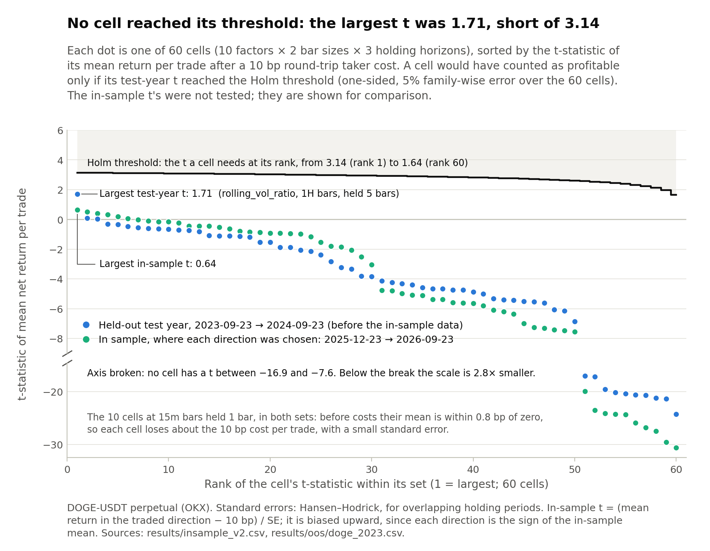
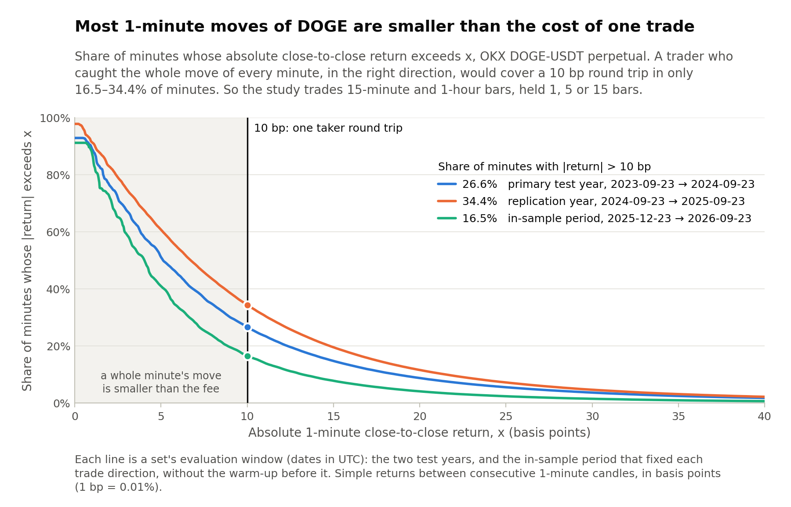
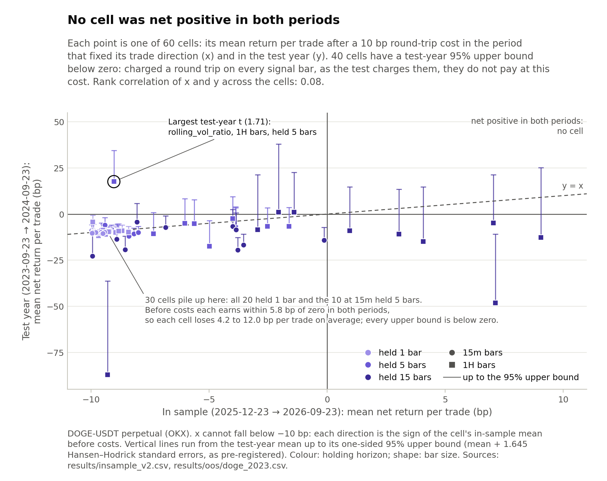
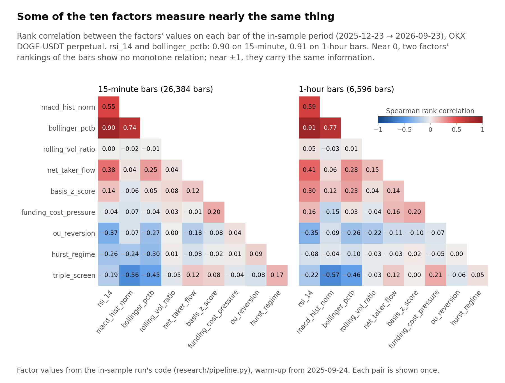

# Do ten factors beat taker costs on the DOGE-USDT perpetual? A pre-registered test

**Question.** Ten trading factors, two bar sizes and three holding horizons make 60 cells. Does any
cell earn a positive mean return per trade on the OKX DOGE-USDT perpetual after a 10 bp taker
round trip, on data it was not developed on?

**Answer.** No cell did.
- **The test.** The primary test year was DOGE from 2023-09-23 to 2024-09-23. On it no cell's mean
  net return was significantly positive (one-sided Holm test over the 60 cells, family-wise error
  5%). The largest t was 1.71, where 3.144 was needed.
- **What the null rules out.** For 40 of the 60 cells, the 95% upper confidence bound on the mean
  net return per trade is below zero (34 if the bound must hold for all 60 at once). Charged a
  round trip on every signal bar, as the test charges them, those cells do not pay at taker cost.
  Every cell at 15m bars and a one-bar horizon loses more than 7.5 bp per trade, with 95%
  confidence over all 60 cells at once.
- **What it does not rule out.** At the longest horizon (1-hour bars held for 15 bars) the test had
  80% power only against net edges of 52 to 123 bp per trade, depending on the cell, so the null
  says little there.
- **The other sets.** A second DOGE year and BTC, ETH and SOL over the primary year agree: no cell
  passed there either. On the two months after the in-sample year, which decide nothing, no cell's
  95% interval lies above zero (§6).
- **Cheaper execution.** On 14 in-sample days of OKX's order-book archive (400 levels a side),
  resting at the best price before crossing cut a round trip from about 11 bp to about 6–8 bp, both
  measured from the mid-price, adverse selection included (§7). It cannot change the answer: before
  costs, in either direction, no cell's t exceeds 2.68 against the 3.144 needed.

**Why the answer can be trusted.**
- **Fixed before the data.** The pre-registration ([`docs/preregistration.md`](preregistration.md))
  fixed the factors, the cells, the statistic, the decision rule and the power analysis before the
  test sets were downloaded; its §3 lists every earlier contact with test-period data, including
  archive files downloaded while planning. It was made public as a GitHub Release, and archived
  with Software Heritage before the first test download.
- **Fixed in sample.** Each cell's trade direction was fixed on the in-sample year and frozen in a
  tagged commit ([`docs/preregistration-freeze.md`](preregistration-freeze.md)).
- **One run per set.** Each test set was run once, by code that refuses to run if anything outside
  `docs/` and `results/` changed after the freeze, if an input differs from its committed hash, or
  if the set already has results. The outputs were committed unedited. The guards cannot stop an
  author who controls the machine: that each set ran once rests on the public commit record and on
  the results being reproducible from public data (§10).
- **Read against the plan.** [`docs/preregistration-results.md`](preregistration-results.md)
  compares the results with the plan section by section. Every departure is in the deviations log
  (§12 of the pre-registration).



---

## 1. Why this is hard: the cost comes first

A round trip at OKX's taker rate costs 10 bp (5 bp a side). The one-minute moves of DOGE are mostly
smaller than that:

| 1-minute returns (bp) | In sample, Dec 2025 – Sep 2026 | Primary year 2023–24 | Replication year 2024–25 |
|---|---:|---:|---:|
| Standard deviation | 10.0 | 14.2 | 15.2 |
| Median absolute return | 4.0 | 5.1 | 6.7 |
| 90th percentile of absolute return | 13.2 | 18.7 | 21.5 |
| Minutes whose whole move exceeds 10 bp | 16.5% | 26.6% | 34.4% |

Each column is a set's evaluation window (§3). In sample, a trader who caught the entire move of a
minute, in the right direction, would still not have covered the fee in 83.5% of minutes. So the study tests 15-minute and 1-hour
bars, held for 1, 5 or 15 bars, where moves are larger relative to the fixed fee.



## 2. Where this started

The first version of this study ("v1", in-sample only, [`docs/factor-research.md`](factor-research.md))
found no factor that beat costs. Building it exposed four broken factors, fixed before v1 ran;
re-reading it afterwards exposed the problems listed in §2 of the pre-registration. The v2 design
answers each one:

- **Broken factors.** Four of the original factors were broken: a basis that was identically zero,
  a funding factor that never reached the model, an open-interest factor paired with candles by
  array index (a look-ahead), and an order-flow proxy that was the return's own sign. They were
  fixed before v1 ran. Open interest was then left out of the study: OKX stamps each value with the start of the
  period it closes, a second look-ahead, and keeps too little history.
- **Models trained on synthetic labels.** The repository's three LightGBM models were trained on
  synthetic labels, so they could only relearn three hand-written rules. v2 tests the factors
  directly and uses no model.
- **Weak inference.** v1 charged one 10 bp round trip against a top-minus-bottom spread that takes
  two, undercharging cost by half; computed its quintile edges over the whole sample, a look-ahead;
  used a √h correction instead of a proper standard error for overlapping trades; chose directions
  and reported results on the same data; and lost its result table to a later partial run.

## 3. Design

All of this was fixed in the pre-registration before the test sets were downloaded. In this
section, § numbers refer to the pre-registration.

- **Factors (§5).** The study has ten factors. Seven come from the trading engine: `rsi_14`
  (14-bar RSI), `macd_hist_norm` (the MACD histogram divided by price), `bollinger_pctb`
  (Bollinger %B), `rolling_vol_ratio` (mean volume over the last 60 bars against the last 1,440: a
  volume ratio, despite its name), `net_taker_flow` (Chaikin money flow over 60 bars, from candles,
  with no trade-side data), `basis_z_score` (z-score of the perpetual–spot basis) and
  `funding_cost_pressure` (z-score of the funding rate). Three were added with an economic
  hypothesis each:
  `ou_reversion` (the next-bar change forecast by a rolling AR(1) fit), `hurst_regime` (momentum
  signed by the variance-ratio regime), and `triple_screen` (a higher-timeframe trend with an
  analysis-timeframe pullback).
- **Trades (§6).** At each bar, a factor above its expanding-window 80th percentile, or below its
  20th, signals a trade, and each such signal bar is one trade, even inside a run of the same
  signal. The trade is entered at the close of the next bar and held for h bars. Its direction is
  the sign the cell had in sample. It pays 10 bp.
- **Statistic (§6.7).** The cell's mean net return per trade, with a Hansen–Hodrick standard error
  for overlapping trades.
- **Decision (§7).** A cell is confirmed if Holm's one-sided test over the 60 cells, at family-wise
  error 0.05, rejects a mean of zero or below on `doge_2023`. The first threshold is t ≥ 3.144.
- **Labels.** Two other sets can only label a confirmed cell:
  - `doge_2024` gives *replicated*;
  - `majors_2023` (BTC, ETH and SOL, pooled) gives *consistent on majors*.
- **Descriptive set.** DOGE after the in-sample year, `doge_fwd`, is descriptive.
- **Power (§9).** Each cell's minimum detectable effect was computed from its in-sample standard
  error and frozen before the download. Every cell's 95% upper bound is reported, so a null can
  rule effects out instead of merely failing to find them.
- **Robustness (§8).** Ten checks are reported and never decide: placebo shifts, quarters,
  leaving out volatile days, costs from 0 to 11 bp, winsorising, funding, the information
  coefficient and others.

| Set | Role | Instruments | Window (UTC) |
|---|---|---|---|
| In-sample | fixes directions and the power analysis | DOGE-USDT-SWAP | 2025-12-23 → 2026-09-23 (warm-up from 2025-09-24) |
| `doge_2023` | primary | DOGE-USDT-SWAP | 2023-09-23 → 2024-09-23 |
| `doge_2024` | replication | DOGE-USDT-SWAP | 2024-09-23 → 2025-09-23 |
| `majors_2023` | other instruments | BTC-, ETH-, SOL-USDT-SWAP | 2023-09-23 → 2024-09-23 |
| `doge_fwd` | descriptive | DOGE-USDT-SWAP | 2026-09-23 → 2026-11-23 |

The primary year comes before the in-sample year because the year in between, `doge_2024`, was
77% covered by the author's earlier research, so it can only replicate; 2023–24 is the most recent
DOGE year that research did not use (§4.1). DOGE's rally in early 2024, inside it, was widely
known; no factor, parameter or threshold was chosen with reference to it, and the pre-registration
cites it only as a reason the test could be liberal, which R1 checks (§3, §6.7).

**Protocol (§10).** The order was:
1. publish the pre-registration;
2. download the in-sample supplement, rerun in sample, and tag the frozen directions;
3. push the freeze amendment;
4. download each test set and commit its manifest;
5. run each set once.

The scripts enforce the order. `scripts/fetch_v2.py` refuses test data until the amendment is on
the public `main`. `scripts/run_oos.py` refuses to run on changed code, on input files whose hashes
differ from their manifest, on directions that differ from the amendment, or on a set that already
has results.

## 4. In sample: weak directions

The in-sample year fixes each cell's direction, and its standard error sets the power analysis:
31 cells buy the factor's top fifth and sell its bottom fifth, 29 the reverse, and none was flagged
for too few trades or a missing input (`results/insample_v2.csv`). Even in sample, no cell's net mean was significant. The largest net t
was 0.64, and only 6 cells had a gross mean above the 10 bp cost. So the out-of-sample test asks
whether directions with almost no in-sample support earn money elsewhere. That is the honest
version of the question v1 asked. v1 picked its best cells on the same data it reported them on.

## 5. Out of sample

The three sets that decide or label cells were run on 2026-10-12. Their full comparison with the plan is in
[`docs/preregistration-results.md`](preregistration-results.md).

**Primary (`doge_2023`).**
- **No cell confirmed.** The largest t was 1.71, for 1H bars, h = 5, `rolling_vol_ratio`
  (+17.6 bp per trade, SE 10.3). Every Holm-adjusted p was 1.
- **Positive cells.** Three cells had a positive mean, and 39 a positive gross mean.
- **Gross means.** Before costs, 3 cells had a gross t above 1.645 and 6 below −1.645. All three
  positive ones are `rolling_vol_ratio` at h = 1 or 5; two of the negative ones are the same factor
  at h = 15, which the in-sample rule traded the other way. The cells share signals (§8), so these
  counts say little on their own; the family-wise placebo, which keeps that dependence, gives no
  cell a p below 0.099.
- **What is ruled out.** 40 cells have a 95% upper bound below zero, including all 20 cells at
  h = 1 and all 10 at 15m, h = 5. At 15m, h = 1 every cell's gross mean lies between −0.65 and
  +0.72 bp. The cost is the whole story there.
- **Power.** The test years were more volatile than the in-sample period (§1), and the frozen
  standard errors had scaled the in-sample ones by sample length only, so the realised ones were
  larger in 58 of 60 cells (median ratio 1.44). At 1H, h = 15 the realised MDEs run from 52 to
  123 bp, so the null says little at that horizon.

**Secondary.** Holm rejected nothing on `doge_2024` (largest t 2.23) or on the pooled majors
(largest t 0.08).

**What the robustness rows show.**
- **The near-miss is one signal.** `rolling_vol_ratio` at 1H, h = 5 is the only cell with
  p < 0.05. Its family-wise placebo p is 0.099. It is +14.3 bp on `doge_2024` and −6.1 bp pooled
  on the majors. A third of its mean comes from the 4% of trades that touch the five most volatile
  days. It is also the study's most persistent signal (mean run 55 hours), for which the test is
  known to be liberal. Under the pre-registered rule it is not confirmed, and these checks leave it
  weak evidence at most. On `doge_fwd` it is +5.9 bp (§6).
- **Prediction without profit.** Seven cells have an information coefficient that is significant
  after Holm. In five of them (`rsi_14` and `bollinger_pctb` at short horizons) the sign is
  opposite to the in-sample direction: high readings were followed by lower returns. But every one
  of the seven has a gross mean within 2 bp of zero, a fifth of the cost. These factors predict
  something, but too little to pay a taker.
- **Persistent signals pay the fee less often than the test charges it.** The test charges 10 bp
  on every signal bar, even inside a run of the same signal, while a position held through the run
  would pay far less. On that turnover-aware basis (R5, which has no standard error) 13 cells are
  positive, six of them among the 40 ruled out above; the largest are `rolling_vol_ratio` at 1H
  (+45.3 and +44.2 bp per day at h = 1 and 5). But before costs no cell reaches the threshold in
  either direction (largest t 2.68 against 3.144), so how often a trade pays the fee cannot change
  the answer.
- **Cheaper execution would not rescue it.** At 4 bp per round trip (maker on both sides, at fees
  not yet verified), no cell reaches the threshold either: 10 cells are positive and the largest t
  is 2.29. That figure also assumes perfect passive fills, which §7 below tests.



In-sample and test-year net means are almost unrelated across the cells (rank correlation 0.08).

## 6. After the in-sample year: `doge_fwd`

`doge_fwd` is DOGE from 2026-09-23 20:00 to 2026-11-23 20:00 UTC, the two months after the
in-sample year. All of it lies after the data the directions were fitted on, and about 70% of it
after they were frozen and published (2026-10-12). Two months is short, so the pre-registration
made the set descriptive: each cell reports its mean and a two-sided 95% interval, and nothing is
decided. It was downloaded and run once, on 2026-11-24.

- **Nothing above zero.** No cell's interval lies above zero, and 35 of the 60 lie entirely below
  it.
- **Short horizons lose the cost again.** The ten cells at 15m, h = 1 have gross means between
  −1.74 and +0.36 bp, and net means between −11.74 and −9.64.
- **The near-miss is smaller, and two months cannot tell.** 1H, h = 5, `rolling_vol_ratio` is
  +5.9 bp, with an interval from −13.6 to +25.3 that contains the primary year's +17.6.
- **Six cells are positive.** All are at 1H and h = 5 or 15, and each interval is at least 36 bp
  wide. The largest is 1H, h = 15, `basis_z_score`: +17.1 bp, from −20.3 to +54.4.
- **Long horizons stay open.** Two months cannot settle the long-horizon cells in either direction.

The pre-registration (§3) lists two looks inside this window during planning: a three-minute poll
of open interest, and the files of an early sketch of the maker probe, covering 2026-10-03 16:00 →
2026-10-05 00:00 UTC. No factor was computed on either, and the cells include that stretch
unchanged.

## 7. Can resting orders do better? The maker probe

Every trade above pays the taker fee on both legs and fills at a bar's close. A resting limit order
pays less (a maker fee of 2 bp instead of 5 per side, at fees the pre-registration calls
unverified) and earns the spread, but it may not fill, and the fills it does get tend to come just
before the price moves against it. The pre-registration (§11) set out to measure both, on 14 days
of the in-sample year drawn at random and recorded in the freeze amendment, from OKX's archive of
the order book (400 levels a side) and of every trade.

**Design.** Every 5 minutes, one contract is posted at the best bid and, separately, at the best
ask, for 60 seconds. If it has not filled by then, it crosses the spread. Two fill rules bracket
what would really happen. M1 counts a fill only when a trade prints through the order's price, or
the other side's best price reaches it. M2 also counts one when a trade prints at the order's price
after the queue ahead of it there has been traded or cancelled away. The simulation engine was committed before the
archive files were downloaded; the files, with their SHA-256, are listed in `results/maker_probe/`.

| Per side, mean of 14 days | M1 (fewest fills) | M2 (most fills) |
|---|---|---|
| Orders filled within 60 seconds | 75–78% | 86–87% |
| Mid one minute after a fill, against the order | 1.0–1.7 bp | 0.2–1.0 bp |
| Cost from the decision-time mid: post, then cross | 3.7–4.0 bp | 2.9–3.1 bp |
| Cost from the decision-time mid: cross at once | 5.5 bp | 5.5 bp |

- **Resting is cheaper, adverse selection included.** Posting first saves about 1.5 to 2.5 bp per side,
  with standard errors across days near 0.1 bp. A round trip falls from about 11 bp, measured from
  the mid, to about 6–8 bp.
- **It does not change the answer.** No cell reaches its threshold even at zero cost (comparison,
  R6), so no way of executing could have rescued the factors.
- **Limits.** The probe posts every 5 minutes, whatever the market does; a factor trades when its
  signal fires, which may meet more or less adverse selection than an average minute. Fourteen
  days, one contract, unverified fees.
- **The data were not quite as planned.** Five of the days have a snapshot of the book every
  minute rather than every 15; the archive has no sequence numbers to detect lost messages; 1,790
  trades that the archive marks `source` 1, which do not behave as prints of the public book, were
  left out; and about 16% of snapshot sides differ from the rebuilt book at the best price, nearly
  all in size only. Each point is in the deviations log, written before the run; the row on the
  snapshot cadence first said every day had a snapshot a minute, and was corrected after the run,
  which checked every snapshot either way. The probe was run both with and without the minutes
  before such a snapshot, and the two agree to within 0.02 bp on the saving. The full table is in
  the [comparison](preregistration-results.md).

## 8. What the factors share



The ten factors hold fewer independent ideas than their number suggests. In sample, `rsi_14` and
`bollinger_pctb` have a rank correlation of 0.90 at 15m and 0.91 at 1H (v1 also found 0.90), and
`macd_hist_norm` correlates 0.74–0.77 with `bollinger_pctb`. So the 60 cells are not 60 independent
tests, and each factor's three horizons also share one signal. Holm's procedure stays valid under
any dependence, but is then conservative. The family-wise placebo, which rotates every signal by
the same offset and so keeps that dependence, gives no cell a p below 0.099 (§5).

## 9. Limitations

- **One exchange, one contract, one fee schedule.** The results speak to OKX's DOGE-USDT perpetual
  at taker cost. The majors set is the same year, so it shows breadth, not independence.
- **Earlier research.** The author's earlier research used DOGE data covering about 77% of
  `doge_2024`, so for the factors it shared that set is not independent of it. It used no DOGE
  data from the primary year, though it analysed BTC 15-minute data over 267 of its 366 days
  (pre-registration §3).
- **Direction rule.** Each cell is tested one-sided, in the direction it took in sample, and those
  directions had almost no support (§4): an edge in the other direction would not have been
  confirmed. Before costs, though, no cell's t exceeds 2.68 in either direction (comparison, R6).
- **Bar-close fills, one bar late.** Every trade fills at a bar's close, a full bar after its
  signal, so a signal that decays within one bar is not tested. That is the right model for a
  taker signal on 15-minute and 1-hour bars, and the wrong one for passive orders. The close is a
  trade price, so the half-spread (about 0.5 bp a side, §7) is not in the 10 bp; R6's 11 bp row
  adds it.
- **Funding timestamps.** OKX's archive stamps some funding settlements up to and including
  2024-01-17 08:00 UTC 1–24 seconds late: every DOGE and SOL settlement up to then, 199 of ETH's
  617, none of BTC's. The frozen code takes them as stamped. That shrinks the
  sample of the funding-included robustness row and slightly delays one factor's input. Neither
  comes near the decision (comparison, *Data*).
- **Power at long horizons.** As above.

## 10. Reproducing it

```bash
git clone https://github.com/ikunfloyd/crypto-factor-validation.git && cd crypto-factor-validation
conda env create -f environment.yml && conda activate doge_trading
python scripts/fetch_v2.py ...                     # download a test set; the commands are in its docstring
python scripts/verify_results.py --set doge_2023   # recompute a set; writes nothing
python scripts/fetch_maker_probe.py                # the probe's 56 archive files (5.2 GB), each checked
python scripts/run_maker_probe.py --verify         # recompute the probe; keeps no file
```

`--set all`, `--set insample_v2`, `--set doge_fwd` and `scripts/make_figures.py` also need the
in-sample files (below).

`scripts/verify_results.py` checks each input file against the SHA-256 in its committed manifest,
recomputes the results through the code path the committed run used, and compares every column of
every committed results file with the recomputation (numbers to 10⁻⁹, everything else exactly). On
2026-11-24, `--set all` reproduced all six results files of the five sets byte for byte, and
`run_maker_probe.py --verify` reproduced the probe's four outputs, apart from a column of run times.
The run scripts themselves will
not run a second time: their outputs are write-once, and a rerun would be a deviation
(pre-registration §10).

**Data.** `scripts/fetch_v2.py` downloads each test set from OKX's public endpoints; the exact
commands are in its docstring. Pass `--manifest` a temporary path, since the committed manifest
already exists and the script never overwrites. A fresh download on 2026-11-24 reproduced the
committed SHA-256 of every `doge_fwd` and `doge_2023` file byte for byte, so for `doge_2023` a
reader's `verify_results.py` run checks the very bytes the committed run read.

The main in-sample files (`data/history/DOGE-USDT-SWAP/`) came from an earlier downloader whose
window ends when it runs, so they cannot be downloaded again byte for byte; their SHA-256 are in
the pre-registration's Appendix A. The supplement in `data/history/is_supp/` came from
`fetch_v2.py`, with its SHA-256 in `results/manifest_is_supp.json`. A download of the same year with
`fetch_v2.py` on 2026-11-24 matched the main files value for value: all 525,598 one-minute candles
the two share, and all 280 funding settlements. The files themselves are not in the repository, so
for `insample_v2`, `doge_fwd` and the figures a reader has to rely on that check. It limits what a
reader can recompute, not the test: the directions were frozen and published before any test set
was downloaded.

The maker probe's 56 archive files are listed, with their URLs and SHA-256, in
`results/maker_probe/manifest_archives.json`. `python scripts/fetch_maker_probe.py` fetches them and
checks each against it, and `python scripts/run_maker_probe.py --verify` recomputes the probe and
compares every output with the committed one, keeping no file.

**CI.** GitHub's CI failed on every push from the repository's first, on 2026-10-12, up to the
`doge_fwd` result on 2026-11-24, always on one test, `test_ignored_files_python_could_import`. The test hard-coded a
macOS file name (`fast.cpython-310-darwin.so`), which Python on Linux does not import as a module;
the check it tests, in `research/gitrepo.py`, was right on both systems. The fix (`9bf6330`) waited
until `doge_fwd` had run, because `scripts/run_oos.py` refuses any change outside `docs/` and
`results/` before then. Every result was computed on macOS.